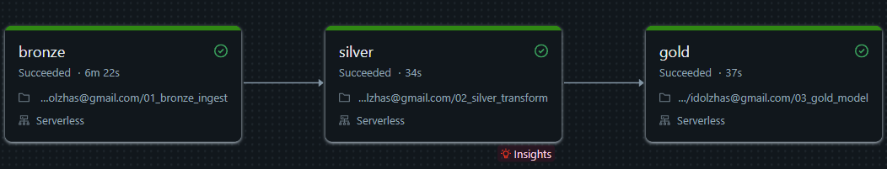
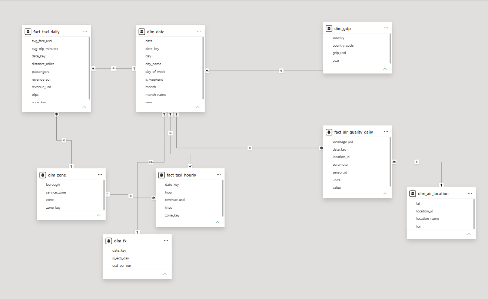
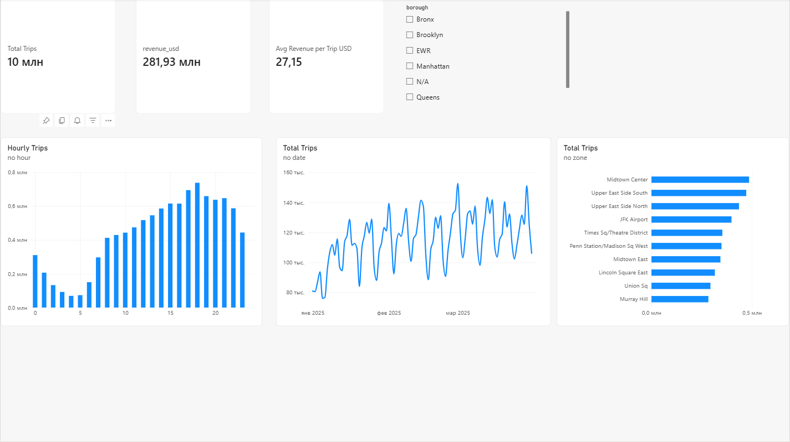
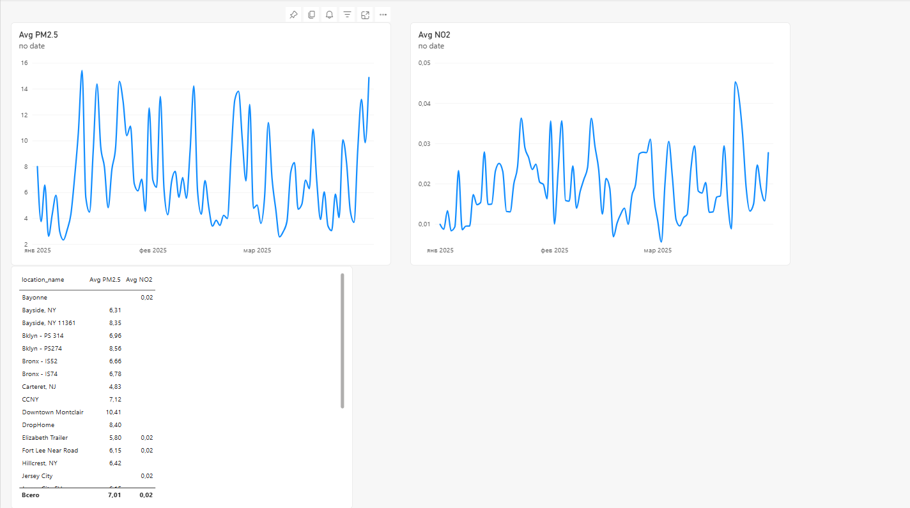
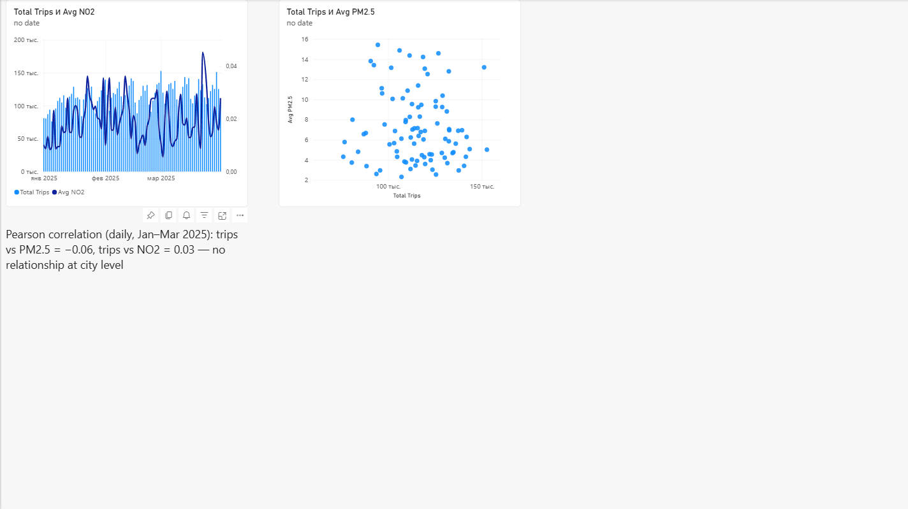
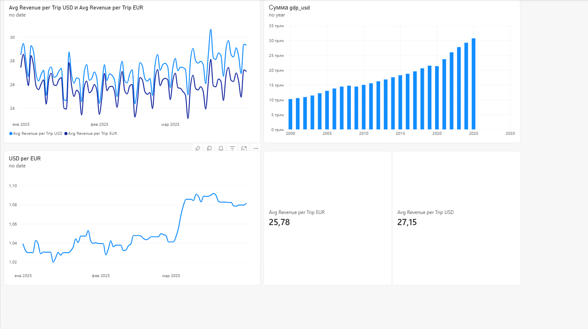

# NYC Mobility, Air Quality & Economy Analytics

Course project (Itransition, Data Engineering): a medallion data platform that combines
NYC Taxi trips, OpenAQ air quality, World Bank GDP and ECB USD/EUR rates, with a Power BI report on top.

**Report (public):** https://app.powerbi.com/view?r=eyJrIjoiODVlNTAyZmYtNTI4NC00M2NjLTlkOTMtNGVjNjBmOWI2MjllIiwidCI6ImMzODBiYTg4LTg4MzQtNGIwNy04ZGU4LWYxYTI3MzlmMDZlNSJ9

**Video demo:** <link>

## Why Databricks instead of Microsoft Fabric

The Microsoft Fabric trial is not available for new tenants (only the Power BI trial was activated),
so the same architecture is implemented on Databricks Free Edition. The PySpark and SQL code moves to Fabric as is.

| Fabric | This project |
|---|---|
| Lakehouse | Unity Catalog schemas `bronze`, `silver` |
| OneLake Files | Volume `bronze.raw` |
| Notebook (PySpark) | Notebook (PySpark) |
| Warehouse | schema `gold` |
| Data Pipeline + schedule | Job `nyc_medallion_daily`, daily |
| Power BI | Power BI (Import mode, published to web) |

## Pipeline

| Layer | Notebook | What happens |
|---|---|---|
| Bronze | `01_bronze_ingest` | Downloads raw files to the Volume and saves them as Delta tables without changes: NYC Taxi Parquet (Jan–Mar 2025), taxi zones CSV, ECB USD/EUR CSV, World Bank GDP JSON, OpenAQ v3 API (stations within 25 km of Manhattan, PM2.5 and NO2 sensors, paginated) |
| Silver | `02_silver_transform` | Types, deduplication, invalid trips removed (out-of-period dates, distance ≤ 0 or ≥ 100 mi, negative amounts, duration ≤ 0 or > 6 h), FX rate forward-filled for weekends and holidays, NaN and negative air values removed, period filter (the OpenAQ API returned more history than requested) |
| Gold | `03_gold_model` | Star schema |

Taxi trips: 11 198 026 in Bronze → 10 382 912 in Silver (815 114, 7.3 %, removed).

## Star schema (Gold)

| Table | Grain |
|---|---|
| `fact_taxi_daily` | day × pickup zone: trips, passengers, distance, revenue USD/EUR, average fare and duration |
| `fact_taxi_hourly` | day × hour × pickup zone: trips, revenue |
| `fact_air_quality_daily` | day × sensor: PM2.5 (µg/m³) or NO2 (ppm) |
| `dim_date`, `dim_zone`, `dim_fx`, `dim_gdp`, `dim_air_location` | dimensions |

## Answers to the key questions (Jan–Mar 2025)

1. **Taxi traffic vs air quality.** Pearson correlation of daily trips with the city average:
   PM2.5 = −0.06, NO2 = 0.03 — no relationship at city level. Taxis are a small share of traffic emissions,
   and daily pollution is driven mostly by weather.
2. **Zones and times.** Busiest pickup zones: Midtown Center, Upper East Side South and North, JFK Airport.
   Demand is lowest at 4–5 a.m. and peaks around 6 p.m. Air data is daily, so the hour-level link
   with pollution cannot be measured with this source.
3. **Revenue per trip in USD vs EUR.** Average $27.15 per trip (€25.78). The euro strengthened in March
   (≈1.03 → ≈1.08 USD), so the same dollar revenue is worth fewer euros: the USD and EUR lines diverge.
4. **Growth vs environment.** Three months are not enough for a multi-year answer. Context: US GDP grew
   from ~$10T (2000) to ~$30T; trips grew from January to March with a clear weekly cycle.

## Report

## Not done

- Purview lineage and row-level security (optional in the task).
- Zone-level air quality: OpenAQ stations are not mapped to taxi zones (would need the zones shapefile);
  some stations within 25 km are in New Jersey.
- Only Jan–Mar 2025 is loaded to keep the free compute limits.

## Run

1. Import the notebooks from `notebooks/` into Databricks.
2. Create schemas and the Volume: `bronze`, `silver`, `gold`, `bronze.raw`.
3. Get an OpenAQ API key and pass it as the `openaq_key` parameter of the `bronze` task.
4. Run the Job: bronze → silver → gold.
